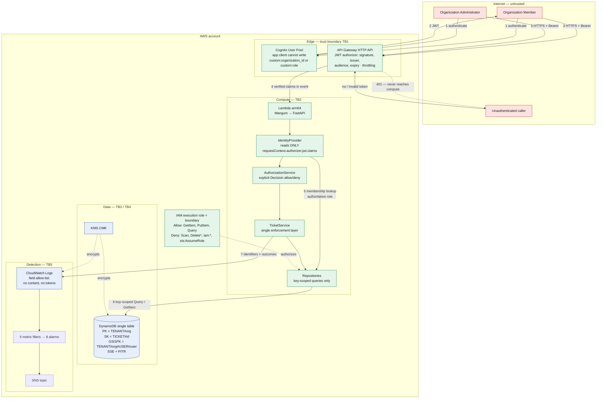

# AWS Proactive Security Engineering & Automated Risk Remediation Platform

A multi-tenant customer support API on AWS, built as an **application security engineering
exercise**: designed, threat-modelled, deliberately written without security review,
reviewed, remediated, and verified — with the evidence for each step kept in the repository.

[](.github/workflows/security-ci.yml)
[](docs/TESTING.md)
[](assessments/security-findings.md)
[](docs/TESTING.md)
[](docs/AWS_DEPLOYMENT.md)

> **Verification status, up front.** Every number in this README was produced by a command
> actually run on 2026-10-23 and is reproducible with the commands given. **Nothing has
> been deployed to AWS**, `terraform validate` has never been run, and the CI workflow has
> never executed. Those gaps are stated wherever they are relevant rather than left for
> you to discover — see [Honest limitations](#honest-limitations).

---

## What this is, and the problem it addresses

A support-ticket API shared by multiple customer organizations. One deployment, one table,
one function, serving every customer. That shape creates a single dominant risk:

> **If one customer can read or modify another customer's tickets, the product is
> unsellable and the breach is reportable.**

Most multi-tenant breaches are not clever. They are a filter that got dropped in a
refactor, a role taken from a token the user could edit, or a permission check that was
written and never called. So the design goal here was not "add security controls" — it was
to make tenant isolation a **property of the architecture** rather than something a
developer has to remember.

Concretely: the DynamoDB partition key *is* the tenant, derived from a gateway-verified
identity, so a query physically cannot cross the boundary. `dynamodb:Scan` is explicitly
denied in IAM, so a future code change cannot regress to reading the whole table. A
caller's role comes from a server-side record, not from their token. And a cross-tenant
request returns the same `404` as a non-existent one — not because of a careful `if`, but
because the partition-scoped read genuinely produces the same answer for both.

### Why there is a deliberately insecure first draft

The application was written twice. The first pass (git tag `v1-pre-review`) is what a
competent engineer under delivery pressure plausibly writes: feature-complete, idiomatic,
and not security-reviewed. It was then reviewed against a 60-item checklist, and every
confirmed weakness was recorded, proven by a test that **failed** against that draft, fixed,
and re-tested.

That is why the findings in this repository are real findings in real code with real
before-and-after output, rather than a list of controls asserted to be present:

```
$ python -m pytest tests/security -q      # against v1-pre-review
93 failed, 102 passed

$ python -m pytest tests/security -q      # against HEAD
195 passed
```

**The author of the first draft and the reviewer are the same engineer.** That is the
weakest form of review, and it is disclosed here and in every document where it matters.

---

## Architecture



Design decisions and their trade-offs: [`docs/ARCHITECTURE.md`](docs/ARCHITECTURE.md).
Components, actors and trust boundaries:
[`threat-model/architecture.md`](threat-model/architecture.md).

---

## Technology stack

| Technology | Why it is here |
|---|---|
| **Python 3.12+** | Lambda-supported runtime; the whole codebase is type-hinted |
| **FastAPI** | Pydantic-backed request validation, so the schema — not the handler — is where a field becomes unwritable |
| **Pydantic v2** | `extra="forbid"` on every request model is the control that closes mass assignment |
| **Mangum** | ASGI-to-Lambda adapter. Lets the same app run under `uvicorn` locally and Lambda in AWS |
| **boto3** | AWS SDK. DynamoDB access uses the `conditions` key-expression builders, never string-built expressions |
| **API Gateway HTTP API** | Validates the JWT **before** any application code runs, so token parsing is outside the app's attack surface |
| **Cognito User Pool** | Identity provider. Configured so the app client cannot write the tenancy or role claims |
| **DynamoDB** | Single table whose partition key is the tenant — isolation becomes an access-pattern property |
| **AWS IAM + KMS** | Least-privilege execution role with explicit `Deny` statements and a permissions boundary |
| **CloudWatch** | Structured-log metric filters, 8 alarms, 4 saved Insights queries, 1 dashboard |
| **EventBridge + SNS** | Optional Security Hub finding pipeline and alarm fan-out |
| **Terraform** | All infrastructure as code; IAM policies kept as committed JSON so CI can gate what actually deploys |
| **GitHub Actions** | 5-stage gated security pipeline |
| **CodeQL / Bandit / pip-audit / Checkov / Ruff** | Semantic analysis, SAST, SCA, IaC scanning, lint (with bandit-equivalent rules) |
| **pytest + moto** | 616 tests, no AWS credentials required |
| **OWASP ASVS / Top 10 / API Top 10, STRIDE, CWE** | The frameworks the requirements and findings are mapped to |

Deliberately **not** used: Kubernetes, microservice orchestration, or any paid service
enabled by default.

---

## Security engineering capabilities

| Capability | Artefact | Evidence |
|---|---|---|
| **Threat modelling** | [`threat-model/threat-model.md`](threat-model/threat-model.md) | STRIDE per data flow across 10 cross-boundary flows → 16 threats, each with preconditions, impact, likelihood, severity, verification method and residual risk. Discarded threats documented with reasons |
| **Security requirements** | [`threat-model/security-requirements.md`](threat-model/security-requirements.md) | 91 testable requirements mapped to ASVS / OWASP: 76 verified, 11 AWS-gated, 4 open |
| **Risk register** | [`threat-model/risk-register.csv`](threat-model/risk-register.csv) | 16 rows × 19 columns: inherent vs residual, owner, next action, review date |
| **Authorization controls** | [`application/app/security/`](application/app/security/) | Explicit `Decision` objects; role from a server-side record; enforcement concentrated in one layer |
| **Manual code review** | [`assessments/code-review-checklist.md`](assessments/code-review-checklist.md) | 60 items across 10 domains, every item with a verdict; 15 findings and 7 observations kept separate |
| **Findings and remediation** | [`assessments/security-findings.md`](assessments/security-findings.md) | 15 confirmed findings with file/line evidence, CWE + OWASP mapping, root cause, fix, and guarding test |
| **Regression evidence** | [`assessments/regression-evidence.md`](assessments/regression-evidence.md) | Verbatim before/after output, including the captured `201 Created` cross-tenant write |
| **Infrastructure security** | [`infrastructure/terraform/`](infrastructure/terraform/) | 10 `.tf` files; Checkov 137 passed / 0 failed / 12 justified skips |
| **Least-privilege IAM** | [`infrastructure/terraform/policies/`](infrastructure/terraform/policies/) | Enumerated actions, ARN-scoped, 2 explicit `Deny` statements, permissions boundary |
| **Security automation** | [`security-automation/`](security-automation/) | Two original CLIs, 3,513 lines, 239 tests |
| **CI/CD security** | [`.github/workflows/security-ci.yml`](.github/workflows/security-ci.yml) | 5 stages, deny-by-default token, a gate that fails on a *skipped* security job, and a gate self-test |
| **Cloud monitoring** | [`infrastructure/terraform/monitoring.tf`](infrastructure/terraform/monitoring.tf) | 5 metric filters, 8 alarms, 4 Insights queries — including one that detects cross-tenant probing |
| **Incident response** | [`runbooks/`](runbooks/) | Two runbooks keyed to real alarm names and thresholds, each documenting its own detection gaps |
| **Risk communication** | [`assessments/executive-summary.md`](assessments/executive-summary.md) | One page, plain language, with an explicit "what we are not claiming" section |

---

## Local setup

No AWS account, no credentials, no Docker.

```bash
git clone <repository-url>
cd aws-proactive-security-platform

python3 -m venv .venv && source .venv/bin/activate
python -m pip install -e '.[dev]'

python -m pytest -q
# 603 passed, 13 skipped
```

Run the API:

```bash
python scripts/local_server.py
```

This serves the **real application** against an in-process mocked DynamoDB, seeded with
synthetic memberships, and prints the demo identities. Full detail:
[`docs/SETUP.md`](docs/SETUP.md).

---

## Testing

```bash
python -m pytest -q                        # 603 passed, 13 skipped
python -m pytest -m unit -q                # 377
python -m pytest -m integration -q         #  43
python -m pytest -m security -q            # 279
python -m pytest -m regression -q          # 141
python -m pytest -m aws -v                 #  13 — skip without a deployment
python -m pytest -q --cov                  # 89% coverage
```

The 13 skips are **present and skipped, not absent** — each names its missing prerequisite,
so the suite reports the gap on every run instead of concealing it.

Reproduce the before/after proof yourself:

```bash
git worktree add /tmp/v1check v1-pre-review
cp -r tests /tmp/v1check/tests_current && cp pyproject.toml /tmp/v1check/pyproject.toml.cur
cd /tmp/v1check && rm -rf tests && mv tests_current tests && cp pyproject.toml.cur pyproject.toml
python -m pytest tests/security -q         # 93 failed, 102 passed
cd - && git worktree remove --force /tmp/v1check
```

Details: [`docs/TESTING.md`](docs/TESTING.md).

---

## Security findings

**15 confirmed · 15 remediated · 15 retested · 0 open.**

| ID | Finding | Severity | CWE |
|---|---|---|---|
| [F-001](assessments/security-findings.md#f-001) | Authentication bypass via client-controlled identity headers | **Critical** | CWE-290 |
| [F-002](assessments/security-findings.md#f-002) | Privilege escalation through a self-asserted role claim | High | CWE-269 |
| [F-003](assessments/security-findings.md#f-003) | Authorization check defined but never enforced on update | High | CWE-862 |
| [F-004](assessments/security-findings.md#f-004) | Mass assignment permits cross-tenant writes | High | CWE-915 |
| [F-005](assessments/security-findings.md#f-005) | Over-privileged Lambda execution role | Medium | CWE-250 |
| [F-006](assessments/security-findings.md#f-006) | Tenant isolation dependent on a filter over a full scan | High | CWE-639 |
| [F-007](assessments/security-findings.md#f-007) | Customer content and bearer tokens written to logs | Medium | CWE-532 |
| [F-008](assessments/security-findings.md#f-008) | Information disclosure through error responses | Medium | CWE-209 |
| [F-009](assessments/security-findings.md#f-009) | Unbounded pagination and request field sizes | Medium | CWE-770 |
| [F-010](assessments/security-findings.md#f-010) | Pagination cursor forwarded to the database unvalidated | Medium | CWE-639 |
| [F-011](assessments/security-findings.md#f-011) | Unvalidated identifiers permit storage-key injection | Medium | CWE-20 |
| [F-012](assessments/security-findings.md#f-012) | Insecure-by-default configuration | Medium | CWE-1188 |
| [F-013](assessments/security-findings.md#f-013) | Missing ticket lifecycle controls | Low | CWE-285 |
| [F-014](assessments/security-findings.md#f-014) | Missing HTTP security response headers | Low | CWE-693 |
| [F-015](assessments/security-findings.md#f-015) | Unconditional writes silently replace records | Low | CWE-362 |

The three worth reading first, because they are the ones that would have caused a breach:

- **F-001** — unauthenticated, remote, attacker-chosen tenant *and* user, full read/write.
  The insecure identity source was the **configured default**.
- **F-004** — a cross-tenant **write** available to any authenticated user by adding one
  JSON field. The captured `201 Created` is in the regression evidence.
- **F-003** — `can_update_ticket()` was defined and never called. Invisible on a quick read
  *because* the helper existed.

Status and deferred safeguards:
[`assessments/remediation-tracker.md`](assessments/remediation-tracker.md).

---

## AWS deployment

> **Nothing has been deployed.** The commands in
> [`docs/AWS_DEPLOYMENT.md`](docs/AWS_DEPLOYMENT.md) are written from the Terraform
> configuration, not transcribed from a run. `terraform fmt`, `validate` and `plan` have
> never been executed — the binary could not be installed in this build environment
> (`releases.hashicorp.com` is outside its egress allow-list).

**Prerequisites:** a sandbox AWS account, Terraform 1.9+, AWS CLI v2, and permissions for
API Gateway, Lambda, Cognito, DynamoDB, IAM, KMS, CloudWatch and SNS.

**Expected cost:** roughly **$1–3/month** for the dev configuration, dominated by the KMS
key (~$1/month, not free tier). Everything expensive is **off by default**: X-Ray,
Cognito advanced security, and Security Hub — which this configuration deliberately does
not enable, because doing so usually enables AWS Config and bills per configuration item.

```bash
cd infrastructure/terraform
terraform init
terraform validate
terraform plan -var-file=../environments/dev/terraform.tfvars -out=tfplan
terraform apply tfplan
# ...
terraform destroy -var-file=../environments/dev/terraform.tfvars
```

**Read the plan before applying.** The deployment guide lists exactly what to check —
including that `APP_IDENTITY_SOURCE` is `gateway` and not `local_test`, which is the
difference between a working authorizer and finding F-001.

Teardown notes, cost traps, the dev-vs-prod posture delta, and a production hardening
checklist: [`docs/AWS_DEPLOYMENT.md`](docs/AWS_DEPLOYMENT.md).

---

## Demo walkthrough

Every output in [`docs/DEMO.md`](docs/DEMO.md) was captured from a real run. Ten minutes,
end to end:

| # | Step | What it shows |
|---|---|---|
| 1 | Run the application locally | 8 security headers and a correlation id on every response |
| 2 | Legitimate API requests | Server sets `organization_id`, `created_by`, `ticket_id`, `status` — the client cannot |
| 3 | Verify tenant isolation | **Five requests, five different refusals:** colleague → 403, other tenant → **404 not 403**, body-supplied tenancy → 422, header-asserted admin role → 403 with a `role_claim_mismatch` logged, suspended membership → 403 |
| 4 | Lifecycle and validation | Member cannot close a ticket (403); closed is terminal (409); `limit` bounds (422); `%23` key-separator injection (422); a hand-forged cross-tenant pagination cursor (400) |
| 5 | Check the logs | **Zero** occurrences of the ticket's title or description, with full `authorization_denied` audit records |
| 6 | Run the security tests | 603 passed, plus the 84-failure proof against the pre-review code |
| 7 | Scan the infrastructure | Checkov 134/0/12 |
| 8 | Run the IAM policy checker | 0 blocking findings — **and the gate self-test proving it rejects an insecure fixture** |
| 9 | Run finding triage | 4 scanner formats → one normalised, deduplicated, prioritised report |
| 10 | Review a security report | [`assessments/executive-summary.md`](assessments/executive-summary.md) |

The one output worth seeing yourself is step 3's **404**. An administrator of another
tenant requests a real ticket id and learns nothing — not that it exists, not that it
belongs to someone else — and that indistinguishability is a consequence of the key design
rather than a branch someone could forget.

---

## Project evidence

Verified on 2026-10-23. Each figure is reproducible with the command shown.

| Metric | Value | Command |
|---|---|---|
| Tests passing | **603** (13 AWS-gated skips) | `pytest -q` |
| Regression tests | **141**, each demonstrated to fail against `v1-pre-review` | `pytest -m regression -q` |
| Failures against pre-review code | **93** (92 passed) | see [Testing](#testing) |
| Coverage | **89%** (2,064 statements) | `pytest --cov` |
| Confirmed findings remediated | **17 of 17** | [`remediation-tracker.md`](assessments/remediation-tracker.md) |
| Lint | **clean** (incl. bandit-equivalent `S` rules) | `ruff check . && ruff format --check .` |
| SAST | **0** at medium+; **0** `nosec` suppressions | `bandit -c pyproject.toml -ll` |
| SCA | 21 packages, **0 vulnerabilities** | `pip-audit` |
| IaC scan | **137 passed, 0 failed**, 12 justified skips | `checkov -d infrastructure/` |
| IAM policy analysis | 1 INFO, **0 blocking** | `iam_policy_checker.py` |
| Local pipeline | **17 of 17 stages pass** | `./scripts/run_security_checks.sh` |
| STRIDE threats | 16, across 10 data flows and 7 trust boundaries | [`threat-model.md`](threat-model/threat-model.md) |
| Security requirements | 91 (76 verified / 11 AWS-gated / 4 open) | [`security-requirements.md`](threat-model/security-requirements.md) |
| Residual risk | **0 critical, 0 high**, 2 medium, 14 low | [`final-security-assessment.md`](assessments/final-security-assessment.md) |

Three genuine failures were found and fixed during the final verification run rather than
written off: two Ruff violations, and a real bug where Checkov writes its JSON report to a
*directory*, which had been silently breaking the triage stage. Recorded in
[`regression-evidence.md`](assessments/regression-evidence.md) §4.10.

---

## Honest limitations

The project's assurance stops here, and saying so precisely is part of the work.

| ID | Limitation | Consequence |
|---|---|---|
| **L1** | **Nothing deployed to AWS.** No account used | Live JWT rejection, real IAM enforcement, Cognito flows and alarm firing are all **unverified**. 13 tests skip for exactly this reason |
| **L2** | **Partly closed.** `terraform fmt` and `validate` ran on a separate machine (Terraform 1.17.0, AWS provider 6.70.0) on 2026-10-23 — the binary is not installable in the build environment. `validate` **found a real defect** (a `templatefile` vars map that had drifted), now fixed, and the configuration is canonically formatted. Two `key_schema` deprecation warnings remain unmigrated. `plan`/`apply` still unrun — that is L1 |
| **L3** | **Substantially closed.** The pipeline runs on GitHub and run `39988484351` was **fully green — all 12 jobs**, `security-gate` included. CodeQL passes. Reaching green took five runs and surfaced five real defects invisible to local analysis. **Remaining:** branch protection is not set, so the gate reports rather than blocks |
| **L5** | DynamoDB behaviour asserted against **`moto`** | Conditional-write semantics and GSI consistency are verified against an emulator, not the real service |
| **L6** | **Security Hub never enabled** | The ASFF transformation is unit-tested with 38 synthetic events; end-to-end delivery is unverified. Off by default |
| **L7** | **Author and reviewer are the same engineer** | The weakest form of review. An independent reviewer would find things this one did not |
| **L8** | No load, fuzz or penetration testing | Flooding risk (T-13) is reasoned about, not measured |
| **L9** | Membership provisioning is out of band and **unimplemented** | The authorization source of truth is populated by a process that does not exist, so its own security is unassessed — which is why that risk is rated Medium |

### Closed since the first assessment (2026-10-23)

- **AR-04 / T-06** — memberships moved to a **dedicated table**, so the execution role now
  holds `GetItem` on the authorization source of truth and no write action at all, with an
  explicit `Deny` on every write. This was the last Medium confidentiality risk, and it
  needed a table split rather than a policy edit: IAM cannot constrain a sort-key prefix.
- **L4** — hashed dependency lock, installed with `--require-hashes`, plus a CI gate that
  recompiles and diffs to catch drift.
- **S-8/9/10** — three AST-based fitness functions that assert the `Scan`, enforcement and
  request-model invariants across the whole module tree rather than at one call site.

### Top three next steps

1. **Deploy to a sandbox and run the 13 AWS-gated tests.** Now the single largest
   assurance gap — closes L1, L2 and L5 in one move, and is the only way to confirm the
   `Scan` and membership-write denials are enforced in practice rather than on paper.
2. **Make `security-gate` the required status check in branch protection.** A fully green
   run is on record; the gate currently reports rather than blocks a merge.
3. **Get an independent review.** The limitation no amount of self-review can close.

---

## Repository layout

```
application/app/            FastAPI service — the code under review
  security/                 identity, authorization policy, errors, HTTP headers
  repositories/             tenant-scoped DynamoDB access, keys, pagination
  services/                 business rules + the single enforcement layer
  models/                   Pydantic request/response/domain models
  observability/            structured JSON logging with a field allow-list
infrastructure/terraform/   10 .tf files + committed IAM policy JSON
infrastructure/modules/     optional Security Hub triage pipeline (off by default)
security-automation/        iam_policy_checker.py, finding_triage.py + tests
tests/                      unit · integration · security · fixtures
threat-model/               architecture · data-flow · STRIDE · requirements · risk register
assessments/                checklist · findings · remediation · evidence · reports
runbooks/                   incident response + report template
scripts/                    local server · pipeline runner · HCL linter · Lambda packager
docs/                       setup · architecture · deployment · security · testing · demo
.github/workflows/          security-ci.yml
```

### Documentation index

| Document | For |
|---|---|
| [`docs/SETUP.md`](docs/SETUP.md) | Install and run locally |
| [`docs/DEMO.md`](docs/DEMO.md) | 10-minute walkthrough with captured output |
| [`docs/ARCHITECTURE.md`](docs/ARCHITECTURE.md) | 15 design decisions with rejected alternatives |
| [`docs/SECURITY.md`](docs/SECURITY.md) | Control inventory and the CI gating contract |
| [`docs/TESTING.md`](docs/TESTING.md) | Suite layout, the 11 skips, the regression experiment |
| [`docs/AWS_DEPLOYMENT.md`](docs/AWS_DEPLOYMENT.md) | Deploy, cost, teardown, production hardening |
| [`docs/REQUIREMENTS_TRACEABILITY.md`](docs/REQUIREMENTS_TRACEABILITY.md) | Capability → implementation → evidence, including gaps |
| [`docs/INTERVIEW_GUIDE.md`](docs/INTERVIEW_GUIDE.md) | 15 technical explanations + 5 scenario questions |
| [`docs/RESUME_BULLETS.md`](docs/RESUME_BULLETS.md) | Verified figures, and what must never be claimed |
| [`assessments/executive-summary.md`](assessments/executive-summary.md) | One page for leadership |
| [`assessments/final-security-assessment.md`](assessments/final-security-assessment.md) | Full report |
| [`IMPLEMENTATION_PROGRESS.md`](IMPLEMENTATION_PROGRESS.md) | Build log |

---

## Scope and safety

All data is **synthetic**. No real customer information exists anywhere in this repository.

The security tooling here is **defensive and local only**. `iam_policy_checker.py` reads
local JSON and Terraform plan output; `finding_triage.py` reads local files. Neither makes
an AWS API call, scans a remote host, or touches a system it does not own. There is no
offensive tooling, no exploitation utility, and no destructive test procedure — deliberately.

Do not point any of it at infrastructure you do not own.

---

## Licence

MIT — see [`LICENSE`](LICENSE), which includes a security-testing scope notice.
