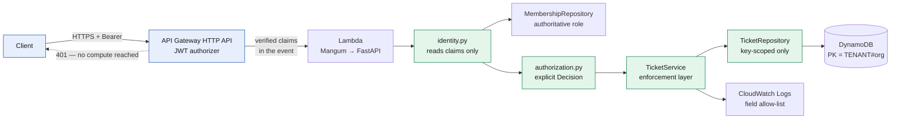

# Architecture and Design Decisions

Component inventory, trust boundaries and the system diagram live in
[`../threat-model/architecture.md`](../threat-model/architecture.md). **This document
covers the decisions and their trade-offs** — what was chosen, what was rejected, and what
each choice costs.

---

## 1. Request path



The layering is strict, and the strictness is the point:

| Layer | Responsibility | Explicitly **not** its job |
|---|---|---|
| API Gateway | TLS, token validation, throttling | Business authorization |
| `routes/` | Transport: parse, validate shape, delegate | Authorization logic |
| `services/` | Business rules **and every authorization enforcement point** | Transport, persistence |
| `security/authorization.py` | Pure policy — returns a `Decision` | Enforcing it, or knowing about tenancy |
| `repositories/` | Tenant-scoped persistence | Authorization decisions |
| `observability/` | Structured logs, field allow-list | Anything that reads request content |

Why it is worth being this rigid: "is every operation authorized?" becomes a question you
answer by reading **one file** (`services/ticket_service.py`). When enforcement is sprinkled
through routes, that question needs a full audit every time — and finding F-003 is exactly
what happens when the audit is skipped.

---

## 2. The decisions that carry the security weight

### D1 — Token validation at the gateway, not in application code

**Chosen:** API Gateway JWT authorizer validates signature, issuer, audience and expiry.

**Rejected:** validating tokens in the Lambda with a JWKS client.

| | |
|---|---|
| **Why** | The application then has **no code path that accepts a token**, so a token-parsing or JWKS-caching vulnerability has nowhere to land. Unauthenticated requests never reach compute — which is also the cheapest possible DoS rejection |
| **Cost** | The behaviour cannot be unit-tested locally. This is a real cost, not a notional one: 11 tests are explicitly skipped and the gateway's rejection of an expired token is **unverified** in this project |
| **Alternative's appeal** | Full local testability, and no dependency on authorizer configuration being right |
| **Why that lost** | It moves cryptographic verification into the blast radius of every application bug, and a misconfigured JWKS cache is a subtler failure than a misconfigured authorizer |

### D2 — Identity from the authorizer context and nowhere else

**Chosen:** read `event["requestContext"]["authorizer"]["jwt"]["claims"]`. No fallback.

Everything a client can influence — headers, query string, body, cookies — crosses the
Lambda boundary **inside the same event object** as the trusted claims. Reading from
anywhere else is not a shortcut, it is an authentication bypass. That is finding F-001,
and it was the default behaviour in the first draft.

Note the specificity: `authorizer.jwt`, not `authorizer`. A REQUEST (Lambda) authorizer
places its context under `authorizer.lambda`; accepting that would honour an identity that
never went through token validation.

**Cost:** local development needs a separate adapter, which is itself a bypass and needs
three independent guards to contain (D9).

### D3 — Role from a server-side record, not from the token

**Chosen:** `resolve_principal` reads `USER#{sub}` / `MEMBERSHIP#{org}` from DynamoDB and
builds the `Principal` with that role. The token's `custom:role` is kept as
`claimed_role` and never used for a decision.

**Why:** a token is a **cached snapshot**. A user demoted or removed five minutes ago still
presents a token asserting the old role. Claim-derived authorization honours a revoked
privilege until expiry; a record lookup does not.

**Cost:** one `GetItem` per request (a `ConsistentRead`, so a revocation is never served
stale). That is a real latency and cost line item, and caching it was deliberately
rejected — caching authorization data is precisely how stale-privilege bugs get
introduced. Recorded as observation O-2.

**Operational payoff:** flipping a membership to inactive revokes access *immediately*.
Runbook A's containment option C3 depends on it.

### D4 — Organization in the partition key

**Chosen:** `PK = TENANT#{organization_id}`, derived from the verified principal.

**Rejected:** a flat table with an `organization_id` attribute and a filter.

**Why:** it makes tenant isolation a property of the **access pattern**. A DynamoDB `Query`
cannot read outside the queried partition, so a cross-tenant result is not *prevented* — it
is impossible. The alternative makes isolation a property of *remembering to filter*, which
is the kind of control that survives code review and then dies in a refactor. Finding F-006
is that exact failure.

**Cost:** cross-tenant administrative queries ("all urgent tickets platform-wide") need a
separate access pattern. Correct trade-off: that is an internal reporting need, and it
should not be served by the tenant-facing path.

### D5 — GSI1 keyed on tenant **and** user

**Chosen:** `GSI1PK = TENANT#{org}#USER#{user}`.

The subtle part: keying the index on the **user alone** would let a user's tickets from one
organization appear in a query scoped to another — reintroducing a cross-tenant path
*through the index* while the base table stayed correctly isolated. A user can legitimately
belong to more than one organization, so this is not hypothetical.

### D6 — No `Scan`, and `Scan` denied in IAM

Application-layer: no `Scan` in any user-facing read path.
Infrastructure-layer: an explicit `Deny` on `dynamodb:Scan` in the execution role.

Two layers because they fail differently. The code control can be undone by a refactor; the
IAM control cannot be undone by a code change, and an explicit `Deny` cannot be overridden
by any later `Allow`.

### D7 — Authorization returns a `Decision`, not a `bool`

```python
@dataclass(frozen=True, slots=True)
class Decision:
    allowed: bool
    reason: str      # machine-readable, for logs. Never sent to a client.
```

**Why:** an unused `bool` is unremarkable; an unused `Decision` that was never passed to
`enforce()` stands out in review. The first draft defined `can_update_ticket()` and never
called it (F-003) — this changes the *class* of defect, not just the instance.

Every decision also carries a reason, which is what gets logged, what the CloudWatch metric
filter counts, and what Runbook A keys off.

### D8 — 404 for cross-tenant, structurally

A 403 for another tenant's ticket and a 404 for a non-existent one is an **existence
oracle**: ids become enumerable across tenants without reading any content.

The implementation does not achieve this with a careful `if`. Because the read is
partition-scoped, another tenant's ticket and a non-existent ticket both produce the same
`None` from the repository — so the identical 404 is a *consequence* of D4 rather than a
branch someone could forget.

### D9 — The local adapter fails closed, three times over

| Guard | Mechanism |
|---|---|
| 1 | `Settings` refuses to load `identity_source=local_test` unless `environment=local` — the Lambda fails to initialise |
| 2 | `LocalTestIdentityProvider.__init__` raises on the same condition |
| 3 | `gateway` is the **default**, and Terraform sets it explicitly |

Plus: the headers are prefixed `X-Local-` so they cannot be confused with a real identity
header and can be stripped by one WAF rule, and construction emits an alarmed event.

Three guards for one adapter looks excessive until you note that this adapter *is* finding
F-001 in a sanctioned form. The failure mode is total.

### D10 — Log field allow-list, not deny-list

A deny-list ("strip anything called `password`") fails the moment someone adds a field. An
allow-list means a field is invisible unless explicitly reviewed and permitted — so the
failure mode of forgetting is **a missing dashboard field, not customer data in a log**.

CloudWatch Logs is a second data store with its own access controls, its own retention, and
a much wider readership than the request that produced the entry.

### D11 — IAM policies as committed JSON, not `aws_iam_policy_document`

**Rejected:** `data "aws_iam_policy_document"`, the idiomatic Terraform choice.

**Why:** a policy document data source is rendered by the **provider at plan time**, so the
resulting policy cannot be inspected without running Terraform against an AWS account. That
means CI cannot gate the policy that actually deploys.

Committing the policies as JSON templates in `policies/` means:

- CI runs the project's own IAM analyzer against the **deployed document**, with no
  hand-maintained copy to drift out of sync.
- A permission change reviews as a *policy diff* in the pull request, not as HCL.
- `${table_arn}`-style placeholders sit inside JSON string values, so the files stay valid
  JSON and any policy linter can read them.

**Cost:** losing the provider's validation of the document structure, and a slightly less
idiomatic Terraform codebase.

### D12 — Pure ASGI middleware instead of `BaseHTTPMiddleware`

Starlette's `BaseHTTPMiddleware` runs the downstream application in a **separate task**,
which breaks `ContextVar` propagation. The request id lives in a `ContextVar` and must be
visible to every log call and to the error handlers, so the middleware has to run in the
same task.

Related: `apply_security_headers` is called **again** inside `_error_response`, because the
unhandled-exception handler runs outside the user middleware stack (Starlette's
`ServerErrorMiddleware` is outermost) — a 500 would otherwise ship with no security headers.

### D13 — Validate the cursor's partition; do not sign the cursor

**Rejected:** an HMAC-signed cursor.

**Why:** a signature proves *we issued it*, not that we issued it **to this tenant**.
Checking `PK == TENANT#{caller's org}` directly is a stronger statement *and* needs no key
to manage or rotate. Finding F-010.

### D14 — Conditional writes on both paths

`attribute_not_exists` on create, `attribute_exists` on update. An unconditional `PutItem`
silently replaces whatever is at the key, which turns an id collision into destroyed data
and lets a service-layer bug create a record *through the update path*, bypassing every
create-time check. Finding F-015.

### D15 — Optional and paid services off by default

Security Hub, X-Ray and SNS email subscriptions are feature-flagged **off**, so the default
`terraform apply` stays inside the free tier. A security project that costs money to look at
does not get looked at.

---

## 3. Data model

| Entity | PK | SK | GSI1PK | GSI1SK |
|---|---|---|---|---|
| Ticket | `TENANT#{org}` | `TICKET#{uuid}` | `TENANT#{org}#USER#{user}` | `CREATED#{iso8601}#{uuid}` |
| Membership | `USER#{sub}` | `MEMBERSHIP#{org}` | — | — |

### Access patterns

| Query | Index | Key condition |
|---|---|---|
| Admin lists org tickets | base | `PK = TENANT#{org} AND SK begins_with TICKET#` |
| Member lists own tickets | GSI1 | `GSI1PK = TENANT#{org}#USER#{user}` |
| Read one ticket | base | exact `(PK, SK)` |
| Resolve membership | base | exact `(PK, SK)`, `ConsistentRead=True` |

Three properties worth noting:

1. **`#` is the separator, so identifiers must not contain it.** Validated as UUIDs at the
   edge and asserted again in every key builder (F-011).
2. **ISO-8601 UTC sorts lexicographically in chronological order**, so GSI1SK needs no
   numeric conversion; the ticket id is appended to break same-millisecond ties.
3. **Memberships share the table but not the partition.** This is the system's known
   architectural weakness: IAM cannot constrain a *sort-key* prefix
   (`dynamodb:LeadingKeys` governs the partition key only), so the role's `PutItem` grant is
   table-scoped and could in principle write a `USER#` item. Compensated by there being no
   code path that does so (test-asserted), by conditional writes, and by explicit `Deny` on
   delete and bulk-write. **The clean fix is a separate membership table, and it is the
   top-priority next step** (AR-04 / S-1).

---

## 4. What this architecture deliberately does not do

| Not done | Why | Consequence accepted |
|---|---|---|
| Per-tenant tables or accounts | One table, one role, one function is far simpler to operate and reason about at this scale | Isolation is **logical**. A customer requiring hard isolation needs a different design (SR-C20) |
| Ticket deletion | Support history is an audit record for a customer relationship | No `DeleteItem` grant and an explicit `Deny`. "Delete my data" requests need an out-of-band process |
| A membership admin API | Removes "grant myself admin" as an application-layer attack entirely | Provisioning is out of band and **not implemented** — so its own security is unassessed (limitation L9) |
| Request-body logging | Debugging uses the request id, not the payload | Harder to debug a malformed client. Correct trade: the alternative is F-007 |
| Per-tenant rate limiting | Stage throttling plus reserved concurrency were judged sufficient at this scale | One tenant's flood degrades everyone (AR-05). Availability is ranked last among the objectives, deliberately |
| Membership caching | Caching authorization data is how stale-privilege bugs appear | One `GetItem` per request (O-2) |

---

## 5. How this scales, and where it breaks first

| Growth | Holds up? | What gives |
|---|---|---|
| More tenants | **Yes.** Partition key is the tenant, so load spreads naturally | Nothing structural |
| More tickets per tenant | **Yes.** All reads are key-scoped and paginated | A very large single tenant creates a hot partition on the admin listing path |
| More roles | **Yes.** Add to `OrganizationRole` and extend the policy matrix; policy functions are pure and exhaustively tested | Nothing |
| More entity types (comments, attachments) | **Mostly.** Same partition, new `SK` prefix | The F-011 key-injection surface grows, and sharing a partition with memberships gets worse — do S-1 **first** |
| More services | **Yes,** if each owns its own table and the membership lookup becomes a shared authorizer | The per-request `GetItem` becomes a cross-service call; that is when caching with explicit invalidation earns its complexity |
| Higher traffic | **Partially.** Reserved concurrency caps spend but *is* the mechanism by which one tenant's spike becomes everyone's throttling | Needs per-tenant usage plans (S-3) before this matters commercially |
| Compliance requiring hard isolation | **No.** This is the first real wall | Requires per-tenant tables or accounts — a different architecture, not a configuration change |
