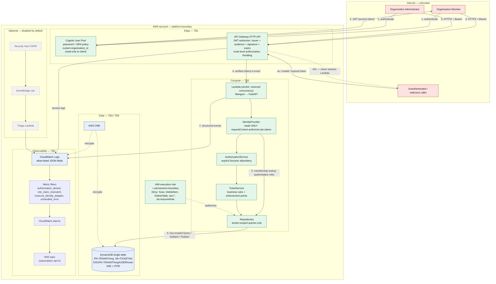

# System Architecture and Trust Boundaries

**System:** Multi-Tenant Customer Support API
**Document owner:** Security Engineering
**Scope of this document:** the components, actors, assets and trust boundaries that the
STRIDE analysis in [`threat-model.md`](threat-model.md) is performed against.

This document describes the system **as implemented** in this repository. Where a control
is aspirational or deferred it is labelled as such; everything else can be traced to a
file in `application/`, `infrastructure/terraform/` or `tests/`.

---

## 1. Purpose and security context

The application is a support-ticket API used by multiple customer organizations
(*tenants*) through a single deployment. The business consequence that drives the entire
security design is simple:

> If organization A can read, create or modify organization B's tickets, the product is
> unsellable and the breach is reportable.

Ticket content is customer-supplied free text. In the real world it reliably contains
things customers should not put in a support ticket — account identifiers, internal
hostnames, occasionally credentials. The design therefore treats ticket bodies as
**confidential customer data** rather than as low-value metadata, which is why they are
excluded from logs (see [§6](#6-logging-and-monitoring-paths)).

---

## 2. Component inventory

| # | Component | Implementation | Security role |
|---|---|---|---|
| C1 | API Gateway HTTP API | `infrastructure/terraform/api.tf` | TLS termination, JWT validation, per-route authorization, throttling |
| C2 | Cognito User Pool | `infrastructure/terraform/cognito.tf` | Identity provider, token issuer, password/MFA policy |
| C3 | Lambda function | `infrastructure/terraform/lambda.tf` | Runs the application; the only compute with data-plane access |
| C4 | FastAPI application | `application/app/` | Request validation, authorization enforcement, business rules |
| C5 | Identity resolution | `app/security/identity.py` | Converts verified gateway claims into a `Principal` |
| C6 | Authorization policy | `app/security/authorization.py` | Explicit allow/deny decisions |
| C7 | Ticket repository | `app/repositories/ticket_repository.py` | Tenant-scoped persistence; no `Scan` |
| C8 | DynamoDB table | `infrastructure/terraform/dynamodb.tf` | Tickets + membership records, SSE at rest |
| C9 | CloudWatch Logs | `infrastructure/terraform/monitoring.tf` | Application logs and API access logs |
| C10 | CloudWatch alarms / metric filters | `infrastructure/terraform/monitoring.tf` | Detection of security-relevant event rates |
| C11 | SNS topic | `infrastructure/terraform/monitoring.tf` | Alarm fan-out (subscription opt-in) |
| C12 | KMS CMK | `infrastructure/terraform/main.tf` | Encryption of table, logs and Lambda env vars |
| C13 | IAM execution role + boundary | `infrastructure/terraform/iam.tf`, `policies/` | Least-privilege data-plane access |
| C14 | Security Hub triage Lambda *(optional, off by default)* | `infrastructure/modules/security_hub_triage/` | Normalizes CSPM findings |
| C15 | CI/CD pipeline | `.github/workflows/security-ci.yml` | Pre-merge security gating |

---

## 3. External actors

| Actor | Authenticated as | Capability | Threat relevance |
|---|---|---|---|
| **Organization Member** | Cognito user, `custom:role=member` | Create tickets; read/update/list **own** tickets | Insider within a tenant; the primary vector for horizontal privilege escalation |
| **Organization Administrator** | Cognito user, `custom:role=admin` | All member rights plus org-wide read/update and ticket closure | Blast radius is one tenant; the target of vertical privilege escalation |
| **Unauthenticated Internet caller** | none | Reach the API endpoint and `/v1/health` | Spoofing, DoS, enumeration |
| **Platform operator / security engineer** | IAM principal | Deploy infrastructure, read logs, triage alarms | Highest privilege; insider risk and credential-theft target |
| **Membership provisioning process** | IAM principal (out of band) | Writes `USER#…/MEMBERSHIP#…` records | Authoritative source of role; compromise = tenant takeover |
| **AWS services** | service principals | Lambda invoke, log delivery, KMS, EventBridge | Confused-deputy risk |

> **Deliberate design note.** There is no self-service endpoint for membership. A user
> cannot create, modify or grant a membership through this API at all, so "grant myself
> admin" has no application-layer path — it requires compromising the provisioning
> process or the IAM principal behind it.

---

## 4. Trust boundaries

| ID | Boundary | What crosses it | What is trusted on the inside | Enforcement |
|---|---|---|---|---|
| **TB1** | Internet → API Gateway | HTTPS request, bearer token | Nothing | TLS 1.2+, JWT authorizer (issuer, audience, signature, expiry), throttling |
| **TB2** | API Gateway → Lambda | AWS_PROXY v2 event | `requestContext.authorizer.jwt.claims` **only** | `app/security/identity.py` reads that path and no other; headers are never an identity source |
| **TB3** | Application → DynamoDB | `Query` / `GetItem` / `PutItem` with key conditions | The IAM role's enumerated actions | Least-privilege role + explicit `Deny` on `Scan`/destructive actions; permissions boundary |
| **TB4** | Tenant A ↔ Tenant B *(logical)* | nothing, by construction | — | Partition key `TENANT#{org}` from the verified principal; GSI1 keyed on `TENANT#{org}#USER#{user}`; cursors validated against the caller's partition |
| **TB5** | Application → CloudWatch Logs | structured JSON log records | Allow-listed fields only | `ALLOWED_LOG_FIELDS` in `app/observability/logging.py` |
| **TB6** | CI/CD → AWS control plane | Terraform plan/apply | Reviewed, merged code | Branch protection, OIDC role (no long-lived keys), security gates |
| **TB7** | Cognito → API Gateway | JWKS, token | Cognito's signing keys | Authorizer configuration pins issuer + client id |

**TB2 is the boundary that matters most.** Everything an HTTP client can influence —
headers, query string, body, cookies — is attacker-controlled and crosses TB2 inside the
same event object as the trusted claims. The single most important property of this
codebase is that identity is read from `requestContext.authorizer.jwt.claims` and from
nowhere else. The pre-review implementation violated exactly this, and it is recorded as
finding **F-001**.

**TB4 is a logical boundary with no network or IAM enforcement.** There is one table, one
role and one function serving every tenant. Isolation is therefore a property of the
access pattern (the partition key is derived from the verified principal) reinforced by
an explicit `Deny` on `dynamodb:Scan`. A design that needed hard infrastructure isolation
would require per-tenant tables or accounts; the trade-off is discussed in
[`../docs/ARCHITECTURE.md`](../docs/ARCHITECTURE.md).

---

## 5. Architecture diagram

---

## 6. Logging and monitoring paths

Two independent log streams, with different trust properties:

| Stream | Produced by | Contains | Does **not** contain |
|---|---|---|---|
| Application log group | the Lambda, via `JsonFormatter` | event type, outcome, reason, `principal_id`, `organization_id`, `resource_id`, changed field **names**, HTTP method/path/status, request id | ticket title or description, tokens, `Authorization` header, email addresses, submitted values from validation errors |
| API access log group | API Gateway | request id, route, status, latency, authorizer status | request or response bodies |

The allow-list is the control (`ALLOWED_LOG_FIELDS`). A field not on that list cannot be
written even if a developer passes it in `extra=`, so the failure mode of forgetting is a
missing dashboard field rather than customer data in a log. Verified by
`tests/security/test_logging_and_data_protection.py`.

Security-relevant events that drive detection:

| `event_type` | Emitted when | Alarm |
|---|---|---|
| `authentication_failed` | no trusted identity on a protected route | — (gateway 401s are counted separately) |
| `authorization_denied` | membership missing/inactive, or policy denial | `authorization_denied` |
| `role_claim_mismatch` | token role ≠ membership role | `role_claim_mismatch` |
| `insecure_identity_adapter_enabled` | the local adapter was constructed | `insecure_identity_adapter` (threshold 1 — should never fire in AWS) |
| `resource_not_found` | ticket absent *or* in another tenant | feeds the cross-tenant probe Insights query |
| `unhandled_error` | unexpected exception | `unhandled_errors` |

---

## 7. Sensitive assets, ranked

| Rank | Asset | Where it lives | Impact if compromised |
|---|---|---|---|
| 1 | Ticket content across tenants | DynamoDB | Multi-tenant data breach; reportable |
| 2 | Membership records | DynamoDB (`USER#…`) | Authoritative role source — write access is tenant takeover |
| 3 | Cognito credentials / tokens | Cognito, client devices | Account takeover within one tenant |
| 4 | Lambda execution role | IAM | Direct data-plane access to the whole table |
| 5 | KMS CMK | KMS | Decryption of table, logs and env vars |
| 6 | Terraform state | S3 backend (operator-provided) | Contains resource ids and can be used to reshape the environment |
| 7 | CloudWatch Logs | CloudWatch | Identifiers and access patterns (content is excluded by design) |

---

## 8. What this architecture deliberately does *not* do

Recorded so reviewers can see these are decisions rather than omissions:

1. **No JWT validation in application code.** Signature/JWKS handling stays at the
   gateway. The application has no code path that accepts a token, so a token-parsing
   vulnerability has nowhere to land. Cost: the behaviour cannot be unit-tested locally —
   covered by explicitly skipped AWS contract tests in
   `tests/integration/test_aws_gateway_contract.py`.
2. **No per-tenant table or account.** One table, one role. Isolation is logical.
3. **No ticket deletion.** The role has no `DeleteItem`, and there is an explicit `Deny`.
   Support history is an audit record.
4. **No admin API for memberships.** Provisioning is out of band by design.
5. **No request-body logging anywhere.** Debugging uses the request id, not the payload.
6. **No authentication on `/v1/health`.** It returns service name, application version and
   environment label only — never the table name, region or identity-provider detail, which
   is test-asserted. Accepted as AR-02.
