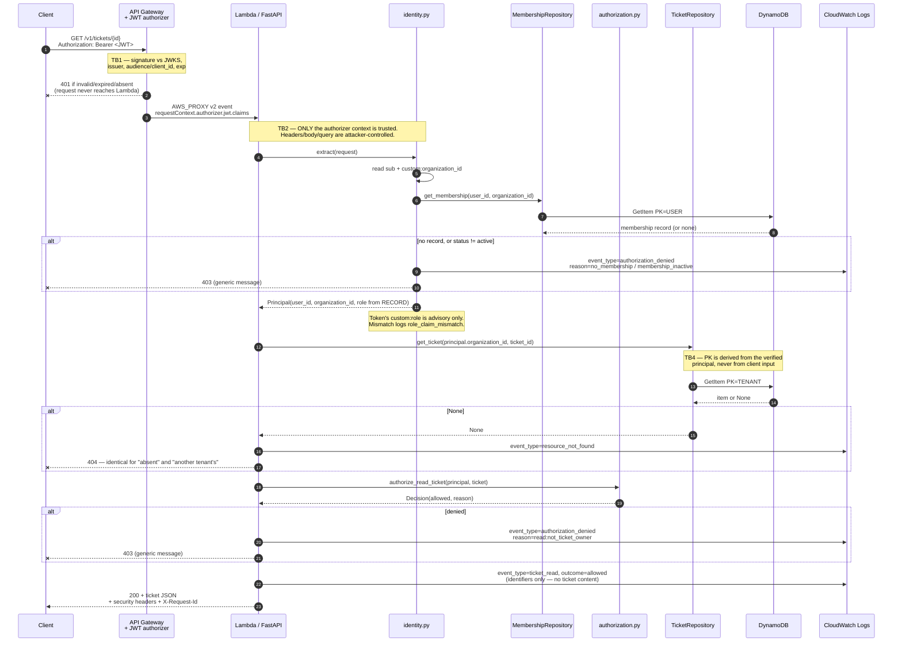
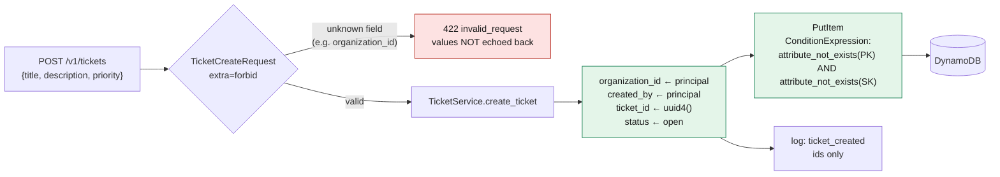
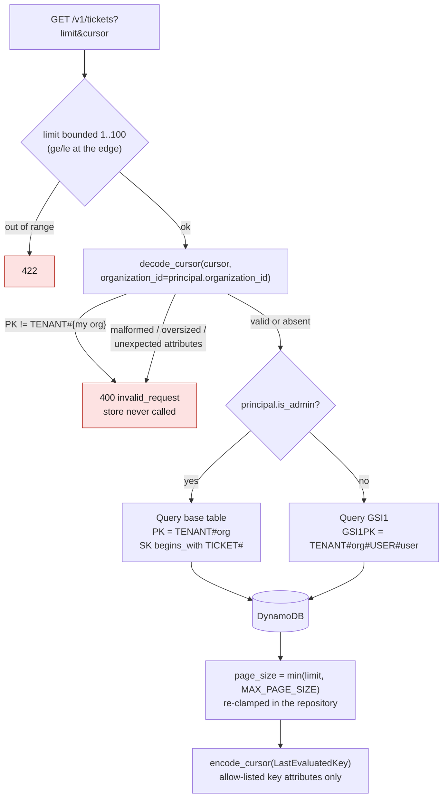
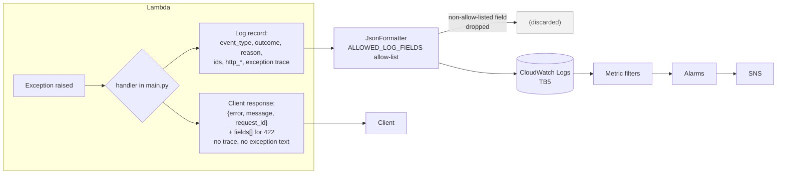

# Data-Flow Analysis

Companion to [`architecture.md`](architecture.md). This document traces each flow that
crosses a trust boundary, states what is trusted at each hop, and names the file that
enforces it. The STRIDE analysis in [`threat-model.md`](threat-model.md) is derived from
these flows.

---

## 1. Primary request flow (authenticated read)

### What is trusted where

| Hop | Input | Trusted? | Why / enforcement |
|---|---|---|---|
| C → G | bearer token | no | Gateway validates it (TB1) |
| G → L | `requestContext.authorizer.jwt.claims` | **yes** | Gateway-verified; `app/security/identity.py` reads only this |
| G → L | headers, query, body | **no** | Never an identity source; body is schema-validated with `extra="forbid"` |
| I → M | `user_id`, `organization_id` from claims | yes (as identifiers) | Used as *lookup keys*, not as authorization conclusions |
| M → I | membership record | **authoritative** | Server-side state; the role decision source (F-002) |
| L → R | `principal.organization_id` | yes | Derived from verified identity; becomes the partition key |
| R → D | key condition | — | Keys built by `repositories/keys.py`, which rejects `#` in identifiers (F-011) |

---

## 2. Write flow (create) — where tenancy is decided

The three fields an attacker would want to control — `organization_id`, `created_by`,
`ticket_id` — are **absent from the request model**. There is no code path from request
body to any of them. With `extra="forbid"`, attempting to supply one is a 422 rather
than a silently-dropped field.

> The pre-review implementation did the opposite: `TicketCreateRequest` declared an
> optional `organization_id`, and the service used
> `payload.organization_id or principal.organization_id`. That let any authenticated user
> **write a ticket into another tenant's partition**. Recorded as **F-004**; regression
> test: `tests/security/test_tenant_isolation.py::test_create_cannot_target_another_tenant_via_request_body`.

---

## 3. List flow — role decides the query, not a filter

Two properties worth naming:

1. **A member's listing is narrowed in the key condition, not after the fact.** Coworkers'
   tickets are never read from the database — not read, not billed, not held in memory.
   The pre-review version used `Scan` with a `FilterExpression` (**F-006**).
2. **The cursor is client-controlled input.** `LastEvaluatedKey` is a plain dict; a
   base64 cursor can be decoded, edited to point at another tenant's partition, and
   re-sent. `decode_cursor` therefore requires `PK == TENANT#{caller's org}` (**F-010**),
   and the repository re-validates any key handed to it directly.

---

## 4. Error and log flow (what leaves the system)

The split is deliberate and is the right way round: **the operator gets the diagnostics,
the caller gets a sentence.** The correlation key is `X-Request-Id`, returned on every
response and present on every log record.

The pre-review implementation returned `str(exc)` and `traceback.format_exc()` in the 500
body (**F-008**) and logged whole request payloads and the `Authorization` header
(**F-007**).

---

## 5. Cross-boundary flow summary

| Flow | From → To | Boundary | Primary risk | Control | Enforced in |
|---|---|---|---|---|---|
| DF1 | Client → Gateway | TB1 | Spoofing, DoS | JWT validation, throttling, TLS | `api.tf` |
| DF2 | Gateway → Lambda | TB2 | Identity spoofing via headers | Claims-only identity source | `security/identity.py` |
| DF3 | Lambda → Membership record | TB3 | Privilege escalation via token claim | Role from server-side record | `security/identity.py`, `repositories/membership_repository.py` |
| DF4 | Lambda → Tickets | TB3/TB4 | Cross-tenant read/write | Partition key from principal; GSI1; no `Scan`; explicit IAM `Deny` | `repositories/ticket_repository.py`, `policies/lambda-execution.json` |
| DF5 | Client body → Storage | TB2 | Mass assignment | `extra="forbid"`; server-set fields absent from request models | `models/ticket.py` |
| DF6 | Client cursor → Query | TB2/TB4 | Cross-tenant pagination | Cursor bound to caller's partition | `repositories/pagination.py` |
| DF7 | Lambda → Logs | TB5 | Sensitive-data exposure | Field allow-list, static messages, truncation | `observability/logging.py` |
| DF8 | Lambda → Client (errors) | TB2 | Information disclosure | Uniform envelope; 404 for cross-tenant; no values echoed | `main.py` |
| DF9 | CI → AWS | TB6 | Unreviewed infrastructure change | Branch protection, OIDC, security gates | `.github/workflows/security-ci.yml` |
| DF10 | Security Hub → Triage Lambda *(optional)* | TB3 | Malformed event / log injection | Schema-tolerant parsing, no finding content logged | `infrastructure/modules/security_hub_triage/src/handler.py` |
